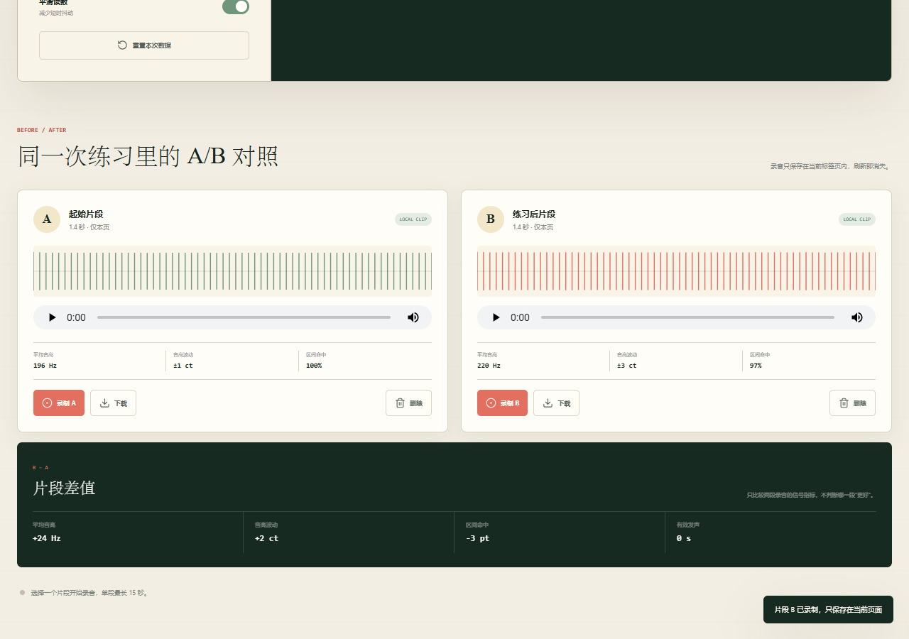
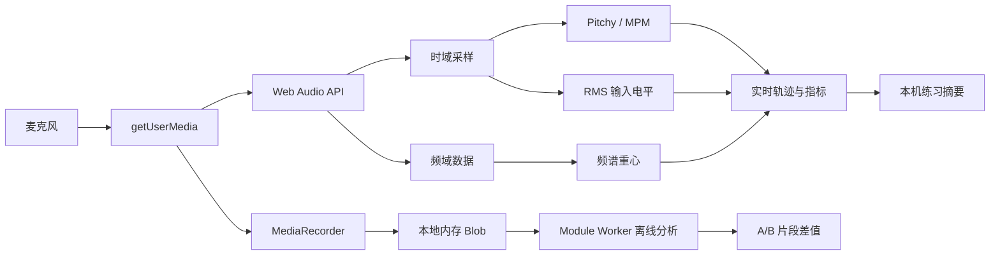

# VoxBloom · 声线练习实验室

VoxBloom 是一款隐私优先、完全在浏览器本地运行的声线练习可视化工具。它实时显示音高、音分、频谱重心、练习区间命中率和音高波动，并支持同一次练习里的 A/B 录音对照。

> VoxBloom 只描述声音信号，不评价性别、passability、声音“好坏”或治疗效果，也不是语音治疗或医疗设备。



## 功能

- **2.0**：无需麦克风即可导入本地音频到 A/B，支持浏览器可解码的 WAV、MP3、M4A、OGG、WebM 等格式（20 MB / 120 秒以内）
- **2.0**：练习摘要 JSON 备份与校验后合并恢复，保留最近 120 条，兼容原有本机摘要
- **2.0**：修正跨音符与跨八度的音高波动统计；显示平滑不再改变练习统计
- 实时基频检测、十二平均律音名与音分偏差
- 可调整的练习音高区间和实时音高轨迹
- 10 / 15 / 30 秒练习目标、完成进度与温和提示
- 频谱重心、输入电平与目标区间可视化
- 实时信号质量、静音输入和接近削波提示
- 持续元音、滑音与短句三种练习模式
- 有效发声时间、平均音高、区间命中率与音高波动
- A/B 本地录音、播放、下载、波形预览和离线音高分析
- A/B 平均值、稳定度、命中率和发声时长差值
- 练习摘要保存在 `localStorage`，可导出 CSV
- 麦克风音频不上传，无账号、分析埋点或远程数据库
- PWA 安装与离线界面，适配手机、平板和桌面
- GitHub Pages、Netlify、Vercel、Docker 和普通静态服务器部署配置

## 为什么用 Pitchy

项目使用 MIT 许可的 [Pitchy](https://github.com/ianprime0509/pitchy) 实现 McLeod Pitch Method。相比自行编写自相关算法，成熟的音高检测库更容易维持可解释性和测试稳定性。

为了保持静态站无需构建，浏览器版本以源码模块保存在：

```text
assets/pitchy.js
assets/fft.js
```

原始许可证与修改说明见 [THIRD_PARTY_NOTICES.md](THIRD_PARTY_NOTICES.md)。

## 音频链路



网络线不存在：麦克风、分析结果与录音均不发送到远程端点。

## 本地运行

需要 Node.js 18 或更高版本。运行应用本身不需要安装依赖。

```bash
node scripts/serve.mjs
```

打开 `http://127.0.0.1:4190`。

运行测试：

```bash
node --test
```

如果要从锁文件恢复开发依赖：

```bash
pnpm install
```

## 麦克风与浏览器支持

- 需要 `MediaDevices.getUserMedia`、Web Audio API 和 MediaRecorder。
- 首次启动麦克风时，浏览器会请求权限。
- 推荐使用最新版 Chrome、Edge、Safari 或 Firefox。
- GitHub Pages 和自定义部署必须使用 HTTPS，`localhost` 是允许的开发环境例外。
- 自托管时需要允许同源页面使用麦克风：

```text
Permissions-Policy: microphone=(self)
```

## 隐私

- 音频分析在当前浏览器的 Web Audio 图中完成。
- 录音片段只存在于当前标签页内存，刷新或关闭页面后消失。
- 练习摘要不包含音频，只保存时间、平均音高、命中率、波动和有效时长。
- 应用不发送音频、指标或导出内容到服务器。
- 浏览器与操作系统自身的音频处理策略仍可能适用。

## 2.0 的导入与备份

在 A/B 卡片中选择“导入 A”或“导入 B”，选取本机音频。导入无需麦克风权限，音频在当前浏览器中解码、分析和播放。格式支持取决于浏览器解码器，导入失败会保留已有片段。每段仍使用录制或导入时的练习区间；两段区间不同时，不显示命中率差值。麦克风录音上限仍为 15 秒。

在“练习摘要”中点击“备份 JSON”，可保存不含音频的摘要文件。“恢复备份”会先校验完整文件，再与本机记录按 ID 去重合并，保留最近 120 条；相同 ID 优先保留本机记录。无效或超过 1 MB 的文件不会导入。CSV 继续用于表格分析，新增 `statistics_version` 列；恢复功能仅接受本应用导出的 JSON。

原有 `voxbloom-settings-v1` 和 `voxbloom-history-v1` 存储键继续使用。1.x 摘要保留并标注“旧算法”，不与 2.0 的波动值直接比较。2.0 波动值是原始有效音高在同一对数音分坐标上的总体标准差，详见 [MODEL.md](MODEL.md)。

同一 GitHub Pages 域名的多个应用可以并存；2.0 的离线缓存更新只清理 VoxBloom 自己的旧缓存。

## 部署

### GitHub Pages

1. 推送项目到 `main` 分支。
2. 打开 `Settings → Pages`。
3. 将 Source 设置为 `GitHub Actions`。
4. `.github/workflows/pages.yml` 会在测试通过后发布。

### Netlify

项目已包含 `netlify.toml`。导入仓库后不需要构建命令，发布目录使用项目根目录。

### Vercel

项目已包含 `vercel.json`。导入仓库后选择 `Other`，不设置 Build Command，输出目录保持项目根目录。

### Docker

```bash
docker build -t voxbloom-voice-lab .
docker run --rm -p 8080:80 voxbloom-voice-lab
```

打开 `http://127.0.0.1:8080`。

## 项目结构

```text
.
├── assets/
│   ├── app.js
│   ├── analysis-worker.js
│   ├── fft.js
│   ├── guide.js
│   ├── icon.svg
│   ├── lucide.min.js
│   ├── pitchy.js
│   └── styles.css
├── licenses/
├── scripts/
│   └── serve.mjs
├── src/
│   ├── audio-math.js
│   └── recording-analysis.js
├── tests/
│   ├── audio-math.test.js
│   └── recording-analysis.test.js
├── .github/workflows/pages.yml
├── index.html
├── guide.html
├── manifest.webmanifest
├── MODEL.md
├── netlify.toml
├── sw.js
└── vercel.json
```

2.0 的摘要校验与备份逻辑位于 `src/practice-data.js`；新增数据恢复、应用导入流程与 Service Worker 隔离回归测试。

## 边界

- 频谱重心不是“共鸣位置”，也不能直接判断头声、胸声或声道状态。
- 音高区间是用户自定义的练习参照，不是疗效标准。
- 一次读数会受设备、麦克风距离、房间反射、噪声门和浏览器音频处理影响。
- 如有疼痛、持续嘶哑、吞咽困难或呼吸不适，请停止练习并咨询合格医疗或语音治疗专业人员。

## 许可

源代码采用 MIT License。第三方组件许可见 [THIRD_PARTY_NOTICES.md](THIRD_PARTY_NOTICES.md)。
